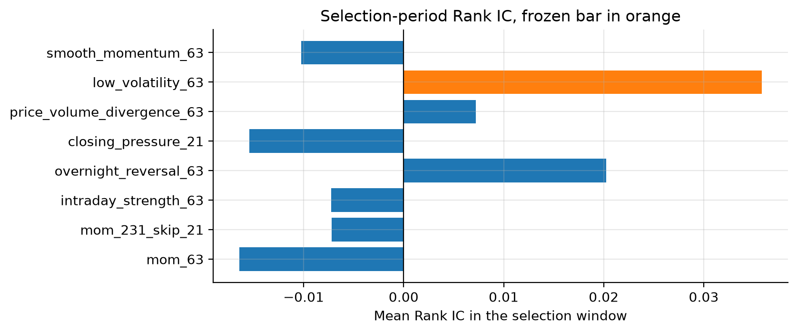
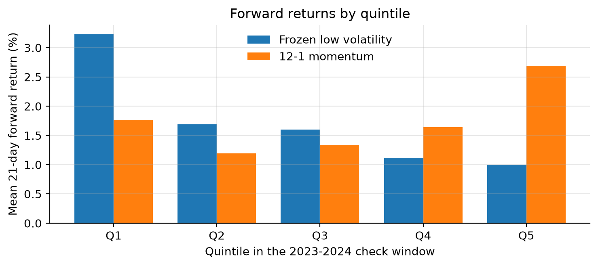

# 002: 量价因子搜索

问题: 六个方向已经固定的量价候选里, 谁在 2021-2022 年的平均 Rank IC 最高, 它在 2023 年以后是否还不差于 12-1 动量.

协议写在 [protocol.json](protocol.json). 窗口和符号在运行前固定, 选择期结束之前不看检查期和留出期.

这一轮对应 QuantToolKit `research/factor_search_20261018`. 任务目录里的表来自另一份本地库. 本机没有那份文件, 所以用工具箱 `data_pipeline` 在 2026-10-28 重新准备了当前标普 500 行情. 下面的数字都来自这次实际运行.

笔记本 [main.ipynb](main.ipynb) 按 QuantToolKit `research/test_momfactors/main.ipynb` 的顺序书写: 读数, 因子和标签, 覆盖, 每日 Rank IC, 重叠标签, 稳健性, 分位, 结论. 图在 [figures](figures), 表在 [outputs](outputs).

## 口径

| 项目 | 约定 |
| --- | --- |
| 数据 | 本项目 `data/quanttoolkit.db` 的 prices 与 universe, 只读 |
| 证券 | 库里已有的全部证券, 不按后来的收益挑股票 |
| 价格 | open, high, low, close, adj_close, volume |
| 主标签 | `future_returns(n_periods=21, gap=1)`, 即 `adj_close[t+22] / adj_close[t+1] - 1` |
| 基准 | `base_momfactor(window=63)` 与 `base_momfactor(window=231, skip=21)` |
| 候选 | 日内强度, 隔夜反转, 收盘位置, 量价背离, 低波动, 路径平滑动量 |
| 发现期 | 2017-01-01 至 2020-12-31 |
| 选择期 | 2021-01-01 至 2022-12-31, 只在这里挑一个候选 |
| 检查期 | 2023-01-01 至 2024-12-31 |
| 留出期 | 2025-01-01 至最后一条完整标签 |
| 共同样本 | 八个因子和标签同时有效, 至少 252 条历史价格变化, 最近 64 条记录成交量大于 0, 标签进出场也有成交量 |
| 截面 | 当天至少 100 只证券才计算 Rank IC |
| 边界 | 标签退出日越过区间终点的信号日剔除, 不改入场日 |
| 时序 | 窗口, gap 和标签都按该证券自己的交易记录计数 |
| 不确定性 | 因子与基准的日 Rank IC 差值, 63 日移动区块, 2000 次, 种子 18 |

隔夜收益使用复权开盘价:

```text
adjusted_open[t] = open[t] * adj_close[t] / close[t]
overnight[t] = log(adjusted_open[t] / adj_close[t-1])
overnight_reversal_63[t] = -sum(overnight[t-62:t+1])
```

成交量为 0 的补齐日不作为真实隔夜, 日内, 收盘位置, 量价或路径平滑.
动量基准仍用补齐后的复权收盘价, 因此更早窗口里的平价补齐会计入 12-1 动量.
未来收益重叠, 只作为诊断, 不复利成净值, 不扣费用.

## 工具箱里直接用的部分

- `data_pipeline.main`: 本机没有现成库时准备 universe, prices 和内部缺行补齐
- `get_duckdb`, `to_date_ticker_frame`: 只读行情和子行业
- `base_momfactor`: `mom_63` 与 `mom_231_skip_21`. 笔记本里和实验面板的最大绝对差是 0
- `base_logvolfactor`: 低波动的标准差, 本实验只额外取负, 与实验面板的最大绝对差也是 0
- `log_returns`, `future_returns`: 单期对数收益和未来标签
- `rank_ic`, `ic_summary`: 每日 Spearman Rank IC, 以及均值, 标准差, 非年化 ICIR, 正值比例. 共同掩码上 `mom_63` 与直接调用 `rank_ic` 的最大绝对差是 0
- `neutralize_by_industry`: 稳健性里的子行业去均值
- `configure_log`, `trace`: 日志写到本实验目录的 `trace.log`

工具箱里没有隔夜反转, 日内强度, 收盘位置, 量价相关和路径平滑动量, 这些写在 `experiment.py`.
`base_reversalfactor` 是收盘到收盘动量取负, 不能代替隔夜反转.
`simple_quantile_long_short` 构造的是多空权重. 本协议要的是五分位未来收益均值, 所以五分位, 区间剔除和区块自助法是新写的.
笔记本里的自相关和 Newey-West 沿用 `test_momfactors` 的诊断, 使用已安装的 `statsmodels`, 不替代协议里的区块自助法.

## 运行

在仓库根目录:

```bash
uv sync --locked
uv run --locked python -c "from quanttoolkit.data_pipeline import main; main(logger_path='logs', data_path='data')"
uv run --locked python experiments/002_factor_search/experiment.py
uv run --locked python experiments/002_factor_search/followup.py
uv run --locked python -m unittest discover -s experiments/002_factor_search -p 'test_*.py'
```

`experiment.py` 先写 `results/selection.csv` 和 `results/frozen_selection.json`, 再评估被冻结的因子.
`followup.py` 不再改首轮选择, 只评估隔夜反转, 并记录追加规则在发现期和选择期是否仍然指向它.
笔记本在实验目录中运行, 依赖组里有 `ipykernel` 和 `matplotlib`.
日志追加在本目录 `trace.log`, 不纳入 Git.

## 这次数据

| 项目 | 数值 |
| --- | --- |
| 行情 | 2016-01-04 至 2026-10-27, 503 只, 1,321,702 行, 2720 个交易日 |
| 补齐日 | volume = 0 的记录 2743 行 |
| 数据库 SHA256 | `237e228b01152eacc68dffafb91c90471f6bd4bd9551b140b366d3ca4d8e13da` |
| quanttoolkit | `75e62159167fba2a13516049fe3b3a4de67286b1` |
| 共同样本 | 499 只至少有一天进入掩码, 每日 460 至 499 只, 均值 482.2 |
| 未进入掩码 | FDXF, HONA, Q, VYLR, 上市时间太短, 凑不满 252 条历史 |

发现期, 选择期, 检查期的天数和 Rank IC 与任务目录里已公布的表一致到约 1e-5.
留出期因为这次行情收到 2026-10-27, 最后一条完整 21 日标签是 2026-09-25, 共 434 天, 比任务目录里记到 2026-09-09 的 422 天更长.

## 结果

选择期平均 Rank IC 最高的候选是 `low_volatility_63`, 数值为 0.03579, 当天数 481.
发现期同一因子是 -0.02833. 冻结记录见 [results/frozen_selection.json](results/frozen_selection.json).



主标签下, 剔除越界标签之后的平均 Rank IC:

| 区间 | 63 日动量 | 12-1 动量 | 低波动 |
| --- | ---: | ---: | ---: |
| 2017-2020 | -0.00630 | 0.00177 | -0.02833 |
| 2021-2022 | -0.01643 | -0.00718 | 0.03579 |
| 2023-2024 | -0.01707 | 0.04763 | -0.04619 |
| 2025 至末个完整标签 | -0.02135 | 0.01547 | -0.07088 |

低波动减去 12-1 动量的日 Rank IC 差值, 63 日区块自助法 2000 次:

| 区间 | 平均差值 | 95% 区间 |
| --- | ---: | --- |
| 2023-2024 | -0.09382 | [-0.16568, -0.01783] |
| 2025 至末个完整标签 | -0.08635 | [-0.20212, 0.04278] |

检查期区间落在 0 以下. 留出期点估计仍为负, 区间跨过 0.
检查期五分位里, 低波动 Q1 的未来 21 日收益高于 Q5, 12-1 动量则是 Q5 更高.



2017 年以后 2446 个完整标签上, 日 Rank IC 的 1 阶自相关约为 0.92 至 0.94.
低波动的 Newey-West 均值约为 -0.0328, 标准误约为朴素标准误的 3.69 倍, 95% 区间仍跨过 0.
5 日和 63 日标签上, 低波动在检查期和留出期仍为负. 子行业去均值之后也没有转正.

## 隔夜反转

追加规则只看发现期和选择期: 两段都为正的候选里, 较小的那段最高. 这次选中 `overnight_reversal_63`, 与任务指定的追加候选一致.
它在发现期和选择期的平均 Rank IC 为 0.02113 和 0.02023.
这是看到低波动在检查期和留出期走弱之后的第二次查看, 不是独立确认.

| 区间 | 63 日动量 | 12-1 动量 | 隔夜反转 |
| --- | ---: | ---: | ---: |
| 2017-2020 | -0.00630 | 0.00177 | 0.02113 |
| 2021-2022 | -0.01643 | -0.00718 | 0.02023 |
| 2023-2024 | -0.01707 | 0.04763 | -0.00928 |
| 2025 至末个完整标签 | -0.02135 | 0.01547 | 0.05309 |

相对 12-1 动量的差值:

| 区间 | 平均差值 | 95% 区间 |
| --- | ---: | --- |
| 2023-2024 | -0.05692 | [-0.12165, 0.00092] |
| 2025 至末个完整标签 | 0.03762 | [-0.09594, 0.16850] |

两段区间都跨过 0, 检查期的上沿只到 0.00092.
按年份比较, 10 年里有 5 年的平均 Rank IC 高于 12-1 动量. 2026 年只覆盖到 9 月 25 日.
检查期五分位不单调, Q1 的未来收益高于 Q5.

21 日标签按子行业去均值后, 留出期隔夜反转从 0.05309 降到 0.02595, 同期 12-1 动量为 0.01959.
5 日标签的检查期, 隔夜反转为 -0.00783, 低于 12-1 动量的 0.02676.
63 日标签按子行业去均值后, 检查期和留出期的隔夜反转都为负.
与 12-1 动量的平均截面秩相关, 检查期约为 -0.221, 留出期约为 -0.257.

## 结论

按预先写好的规则, 这次冻结的是低波动. 它在选择期的 Rank IC 最高, 检查期相对 12-1 动量的区块区间位于 0 以下, 留出期的点估计仍为负.
隔夜反转在前两段样本上为正, 留出期的点估计也高于 12-1 动量, 但区间很宽, 检查期的方向已经转负, 换持有期和去掉行业均值之后优势不稳定.
目前只能把隔夜反转留成一个公式明确的研究候选, 还不能说它已经不差于 12-1 动量.

## 局限

当前成分是 2026-10-28 的名单, 回溯历史有存活和成员偏差.
本机没有任务目录的原始数据库, 早段结果接近已公布的表, 留出期比那份表多出约两周的完整标签.
发现期和选择期参与了挑因子. 即使不把这次叫做样本外, 也不能保证这些日期从未用于更早的实验.
重叠标签上的 Rank IC 和五分位均值都不是可交易净值.
区块区间没有预设不劣界值, 也没有校正多次查看.
原始行情的复权质量没有在本轮逐笔审计.
